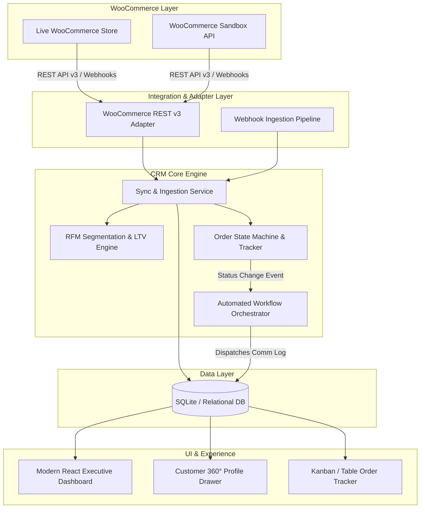

# Architecture Specification: WooCommerce CRM Integration Engine

## 1. System Overview
The **WooCommerce CRM Integration Engine** is an enterprise-grade Customer Relationship Management system designed to seamlessly ingest, track, segment, and automate communication workflows based on store activity from WooCommerce.

---

## 2. Design Patterns Applied

### 2.1 Adapter Pattern
- **File:** `backend/app/services/woocommerce_client.py`
- **Purpose:** Decouples the CRM from the concrete WooCommerce instance. The client normalizes communication using standard WooCommerce REST API v3 authentication (Basic Auth Consumer Key & Consumer Secret) and request headers.
- **Portability:** Switching from Sandbox to a live production WordPress WooCommerce site requires changing only the `WOOCOMMERCE_BASE_URL` in `.env`.

### 2.2 Event-Driven Architecture (EDA) & Webhooks
- **File:** `backend/app/api/webhook_routes.py`
- **Purpose:** Responds to real-time events (`order.created`, `order.updated`, `customer.created`) without waiting for periodic polling intervals.

### 2.3 Repository / Service Pattern
- **File:** `backend/app/services/crm_service.py`
- **Purpose:** Encapsulates business logic (RFM tier scoring, LTV aggregation, average order value computation, and workflow triggers) away from route handlers and database models.

---

## 3. Core Capabilities

### 3.1 Customer Data Management & RFM Segmentation
- **LTV Calculation:** Aggregates valid non-cancelled orders to compute total customer lifetime value.
- **RFM Segmentation Matrix:**
  - **VIP:** Spent $\ge$ \$1,000 OR Orders $\ge$ 4
  - **Loyal:** Spent $\ge$ \$400 OR Orders $\ge$ 2
  - **New:** Orders = 1
  - **Lead / At-Risk:** Inactive or 0 orders
- **Customer 360° Profile:** Single-pane-of-glass showing billing, shipping, complete order history, and chronological communication logs.

### 3.2 Order Tracking & Pipeline Management
- Ingests order details including monetary totals, taxes, shipping, payment methods, line items, and notes.
- Bidirectional status synchronization: Changing an order status in the CRM can automatically update the live WooCommerce store.

### 3.3 Automated Communication Workflows
- Trigger-action framework listening for order lifecycle hooks:
  - `order.created` $\rightarrow$ Triggers confirmation & welcome email
  - `order.completed` $\rightarrow$ Triggers post-purchase satisfaction & review email
  - `order.cancelled` $\rightarrow$ Triggers customer support retention notification

---

## 4. Phase 2 Roadmap: LLM & Agentic AI Integration
Because the backend is built on **Python (FastAPI + Pydantic)**, integrating Agentic AI in Phase 2 is turnkey:
1. **Tool-Calling Agent:** Expose CRM services as native LLM tools:
   - `get_customer_profile(email)`
   - `get_order_timeline(order_id)`
   - `draft_personalized_outreach(customer_id, context)`
2. **AI Churn Risk Prediction:** An agent evaluating days-since-last-order, ticket tone, and order frequency to assign a churn risk score.
3. **Autonomous Customer Support Agent:** Multi-turn conversational agent answering customer order queries with live WooCommerce store context.
