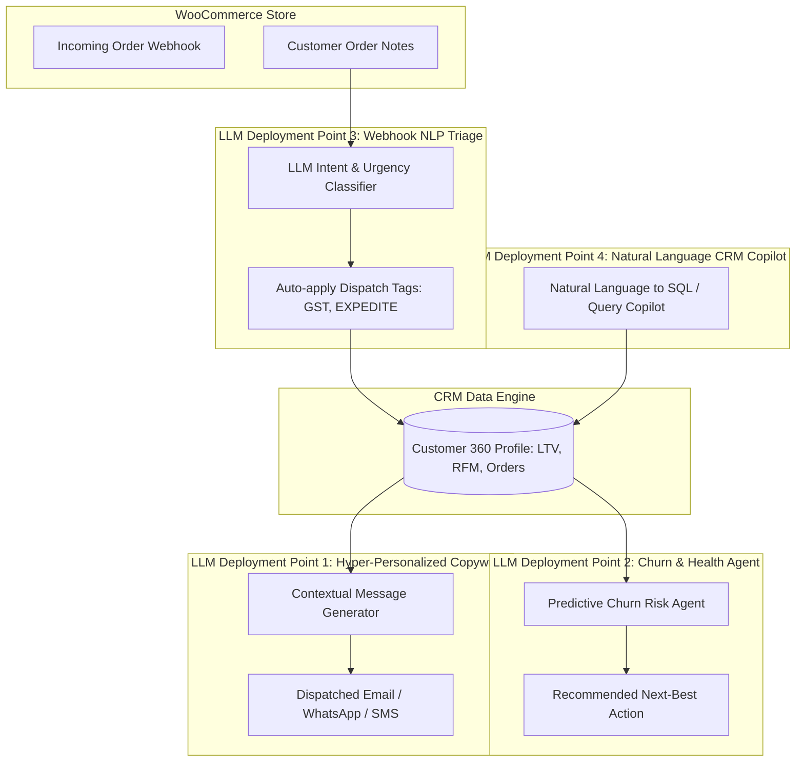

# Where LLM & Agentic AI Can Be Deployed in this CRM

This document details the exact architectural insertion points where Large Language Models (LLMs) and Autonomous AI Agents can be deployed to transform this WooCommerce CRM into an intelligent enterprise system.



---

## 🎯 The 4 High-Impact LLM Deployment Points

### 1. Contextual Customer Outreach Copywriter
* **Where:** Inside the Customer 360° Profile Drawer & Workflow Engine (`POST /api/ai/draft-communication`).
* **Why:** Generic automated emails have poor open and conversion rates. An LLM agent synthesizes customer lifetime value (LTV), city context (e.g. Bengaluru, Panaji, Mumbai), and purchase history to draft individualized emails, WhatsApp messages, or festive offers.
* **Prompt Structure:**
  ```python
  prompt = f"""
  You are an expert CRM retention specialist for KILOWOTT India.
  Write a {channel} to {customer.first_name} located in {customer.city}.
  Customer RFM Tier: {customer.tier}
  Lifetime Value: ₹{customer.total_spent:,.2f}
  Recent Purchase: {order.items}
  Objective: {intent} (e.g. Diwali festive reward / post-purchase check-in)
  Tone: Warm, respectful Indian e-commerce etiquette.
  """
  ```

---

### 2. Predictive Churn Risk & Health Scoring Agent
* **Where:** Executive Dashboard & Customer Segmentation views (`GET /api/ai/churn-risk/{customer_id}`).
* **Why:** Identifies customers likely to churn before they leave. Evaluates purchase cadence, days-since-last-order, payment methods (UPI vs Cash-on-Delivery), and return requests.
* **Agent Output:**
  - Churn Risk Score: `0% - 100%`
  - Risk Level: `LOW`, `MODERATE`, `HIGH`
  - Root Cause Rationale
  - Actionable Strategy: (e.g. *"Dispatch ₹500 WhatsApp accessory voucher valid for 48 hours"*).

---

### 3. Autonomous Webhook NLP Triage Agent
* **Where:** Real-time Webhook Ingestion Pipeline (`POST /api/webhooks/woocommerce` & `POST /api/ai/triage-note`).
* **Why:** Customers frequently leave critical instructions in unstructured WooCommerce order notes (e.g. *"Urgent delivery required for wedding at Taj Panaji! Please call security desk on arrival."*).
* **What the Agent Does:**
  1. Detects urgency (`HIGH` vs `NORMAL`).
  2. Extracts logistics flags: `EXPEDITE_SHIPPING`, `SPECIAL_DELIVERY_INSTRUCTION`, `GST_INVOICE_REQUIRED`.
  3. Auto-tags the order and notifies the fulfillment warehouse in real time.

---

### 4. Natural Language CRM Copilot (Tool-Calling Agent)
* **Where:** Executive Search Bar & Slack/WhatsApp Bot Integration.
* **Why:** Business owners shouldn't have to write complex SQL queries or navigate 5 filters to get insights.
* **Example Queries:**
  - *"Which VIP customers in Bengaluru have not purchased in over 45 days?"*
  - *"How much revenue did we generate from UPI transactions this week compared to COD?"*
  - *"Draft a follow-up email to all customers who placed orders above ₹10,000 yesterday."*

---

## 💻 5-Minute Implementation Snippet (Gemini / OpenAI)

Because our backend runs on **Python FastAPI with Pydantic**, connecting an LLM model takes just 5 lines:

```python
# backend/app/services/llm_connector.py
import os
from google import genai

client = genai.Client(api_key=os.getenv("GEMINI_API_KEY"))

def generate_with_gemini(prompt: str) -> str:
    response = client.models.generate_content(
        model="gemini-2.5-flash",
        contents=prompt,
    )
    return response.text
```
